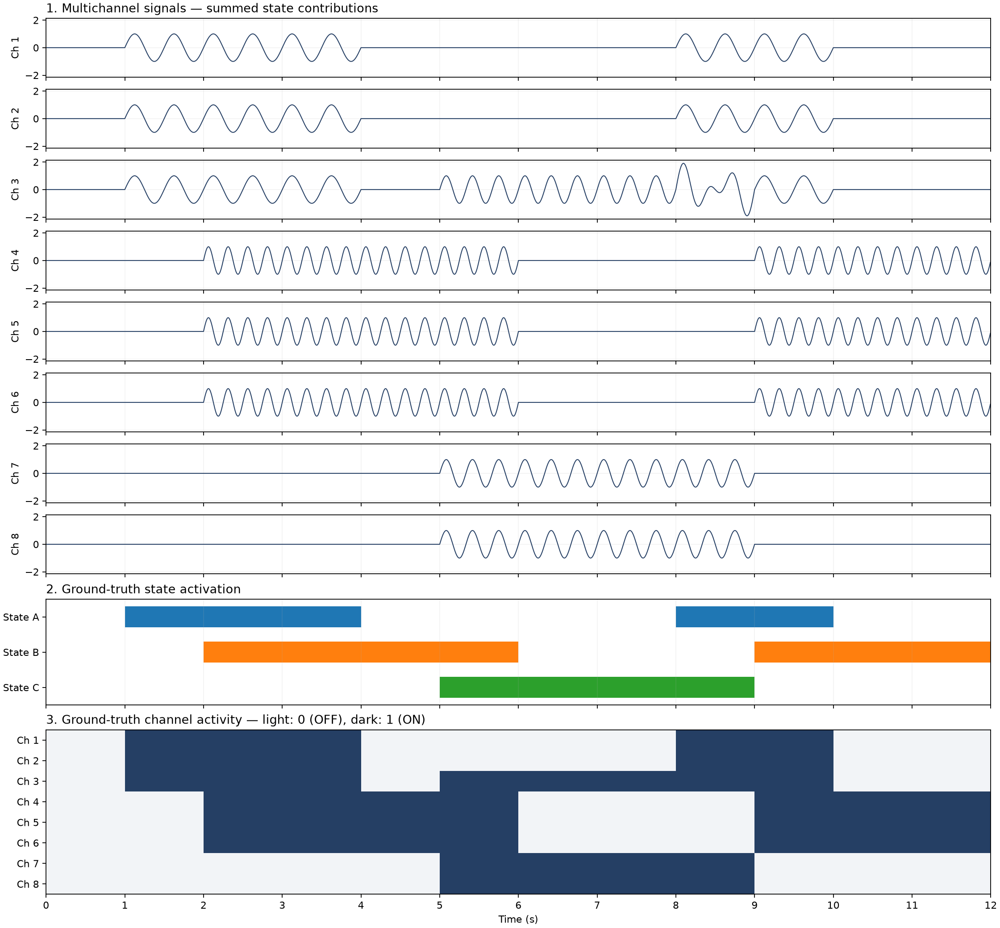

# Overlapping brain states in synthetic recordings

**Exploratory research prototype.** This project investigates groups of channels
that activate together while allowing several states to coexist and share
channels. It uses synthetic ground truth to study what the methods recover and
where they fail. It is not a validated neuroscience analysis package.

The pipeline is **synthetic signals → RMS activity → overlapping Boolean
factors → separate ground-truth evaluation**. A second experiment studies
static and dynamic Jaccard connectivity without introducing another detector.



## Install

Python **3.10 or newer** is supported; the preserved reference experiments used
Python 3.12. The runtime dependencies are NumPy and Matplotlib. Tests use the
standard library's `unittest`.

From a clone, create and activate an environment:

```powershell
# Windows PowerShell
py -3.12 -m venv .venv
.\.venv\Scripts\Activate.ps1
python -m pip install --upgrade pip
python -m pip install -e .
```

```bash
# Linux/macOS
python3 -m venv .venv
source .venv/bin/activate
python -m pip install --upgrade pip
python -m pip install -e .
```

For the exact reference dependency versions on Python 3.12, install with
`python -m pip install -c configs/reference_constraints.txt -e .` instead.
The optional historical clustering experiment requires
`python -m pip install -e ".[legacy]"`; the current research pipeline does not.

## Quick start

Run this command **from the repository root**:

```bash
python -m brain_states.simulation --no-show
```

It saves the original 8-channel recording and a figure to `output/`. Omit
`--no-show` to display the figure on a machine with a working graphical backend.
Output directories are created automatically.

## Run the experiments

Execute these in order when starting without generated files. All commands
work on Windows, Linux and macOS after installation.

| Experiment | Command | Main outputs |
|---|---|---|
| Generate signals | `python -m brain_states.simulation --no-show` | `output/overlapping_signals.npz`, signal PNG |
| Noiseless baseline | `python -m brain_states.experiments.baseline --no-show` | `output/detection_v1/` |
| Fixed-RMS noise robustness | `python -m brain_states.experiments.noise_robustness --no-show` | `output/noise_experiment_a/` |
| Paired adaptive comparison | `python -m brain_states.experiments.adaptive_rms --no-show` | `output/adaptive_comparison/` |
| Static/dynamic connectivity | `python -m brain_states.experiments.connectivity --no-show` | `output/connectivity_experiment_c/` |
| Noiseless meeting figures | `python -m brain_states.experiments.presentation` | `presentation_figures/` |
| Noise meeting figures | `python -m brain_states.experiments.noisy_presentation` | `presentation_figures/noise_comparison/` |

The baseline reads the generated recording. The paired adaptive comparison
checks the preceding noise study when matching saved seeds are available.
Noiseless presentation plots load the saved baseline; noise presentation plots
load the saved adaptive configuration and run actual inference. The noise
studies each use 30 runs per noise level and take longer than the baseline.
Use `--help` to see input, output, seed and plotting options. Connectivity
supports `--activity-method adaptive` and optional `--animate`.

Equivalent `brain-states-*` console commands are installed by `pip`. Old root
commands, such as `python overlapping_signals.py --no-show` and
`python run_detection.py --no-show`, remain supported by thin compatibility
launchers. The canonical implementation is under `src/brain_states`.

## Methods and configuration

- **Simulation:** 8 channels at 200 Hz over 12 seconds. ON states contribute
  unit-amplitude sine waves; OFF states contribute zero. Contributions sum on
  shared channels. Optional independent Gaussian noise is added everywhere.
- **Activity:** centered RMS uses a requested 100 ms window (21 samples at
  200 Hz). Fixed detection thresholds at 0.05. Adaptive detection uses
  `max(0.05, 1.5 × channel's 20th-percentile RMS)`.
- **State discovery:** deterministic greedy Boolean factorization balances
  reconstruction mismatch against state/membership complexity penalties.
  Overlapping and recurring states are permitted; the number is not supplied.
- **Evaluation:** only after inference, one-to-one matching aligns arbitrary
  labels. Temporal IoU and membership Jaccard penalize unmatched states.
- **Connectivity:** Jaccard similarity between channel activity timelines,
  once over the whole recording and in 1-second windows every 0.1 seconds.
  The diagonal and empty-union connectivity are zero.

Start with [`brain_states.config`](src/brain_states/config.py) or print its
registry with `python -m brain_states.config`. It gathers simulation settings,
state definitions, detector dataclasses, noise levels, seeds and connectivity
settings without changing their original values. CLI options override the
corresponding defaults. Low-level scientific APIs retain their established
function signatures and defaults. See [configuration guidance](configs/README.md)
and [method details](docs/methods.md) before changing a research configuration.

## Understand the arrays and outputs

| Quantity | Shape | Meaning |
|---|---|---|
| Recorded signals `X` / `signals` | `(channels, samples)` | Observed sine contributions plus optional noise |
| Channel activity / `channel_activity` | `(channels, samples)` | Binary activity estimated from observations |
| Memberships `W` / `memberships` | `(channels, states)` | Which channels belong to each inferred state |
| State activations `H` / `state_activations` | `(states, samples)` | Independent binary state timelines |
| Static adjacency / `static_adjacency` | `(channels, channels)` | Weighted functional coactivity |
| Dynamic adjacency | `(windows, channels, channels)` | Windowed functional coactivity |

Channel activity is **not** an adjacency matrix. The two are deliberately named
separately in the API and saved files. The generator's truth uses
`channel_activations`, `state_memberships` and `state_activations`; observed-only
detectors receive neither memberships nor activation labels.

Load numerical files using `np.load(path, allow_pickle=False)`. CSV/JSON outputs
contain activity precision/recall/F1, state temporal IoU, membership Jaccard,
state counts, unmatched-state information and reconstruction error. Matched-only
and unmatched-penalized scores are separate. Reconstruction error compares the
factorization to **estimated activity**, unless explicitly labelled against
truth. PNG/PDF presentation plots contain one illustrative realization rather
than repeated-run averages. [Output schemas](docs/outputs.md) describe the files.

Generated artifacts remain on disk but are ignored by Git. Small example PNGs
are retained under `docs/assets/`; compact reference metrics are in
`docs/reference_results/`. Regenerate recordings and meeting figures with the
commands above rather than committing environments or temporary datasets.

## Reproducibility and reference results

The baseline reference is activity F1 **0.989734**, temporal IoU **0.978308**,
membership Jaccard **1.0**, and **3** discovered states. These numbers are
regression targets, not detector inputs or hardcoded outputs.

Simulation noise defaults to seed 42. Repeated experiments use base seed
20261012 with one `SeedSequence` child per realization. The paired comparison
reuses exactly the same recordings across detectors. Meeting figures use seed
20261015 and scale one shared standard-normal realization. Zero-noise repeated
runs are necessarily identical. Saved configuration, per-run seeds and software
versions document the experiments. Historical provenance files may contain
old source hashes and local paths; they are preserved locally and ignored by
Git rather than rewritten to imply a new experiment.

See [reproduction and verification](docs/reproducibility.md) for the test suite,
full workflow and refactor checks. The pre-refactor notes remain available as
[historical experiment notes](docs/experiment_notes.md).

## Limitations

Signals and white noise are simplified models. RMS blurs transition timing and
can miss weak/cancelling activity. Fixed RMS fails under modest noise; adaptive
RMS helps at lower levels but can lose recall as distributions overlap. High
activity F1 does not guarantee good state recovery. Boolean decompositions can
be non-unique and this greedy subset search is limited to 16 channels. A low
reconstruction error alone is not evidence of recovered brain states.

Jaccard can equal one for channels in **different simultaneously active states**.
It describes coactivity, not anatomy or uniquely recovered state-specific
connectivity. See [methods and limitations](docs/methods.md).

## Tests and contributing

```bash
python -m unittest discover -s tests -v
```

CI runs the test suite on Python 3.10 and 3.12 and checks a small headless
workflow. See [contributing](CONTRIBUTING.md) and the [GitHub preparation guide](docs/github.md).
No repository has been created or pushed automatically. A license has not been
selected; the project owner should choose one before public distribution.
